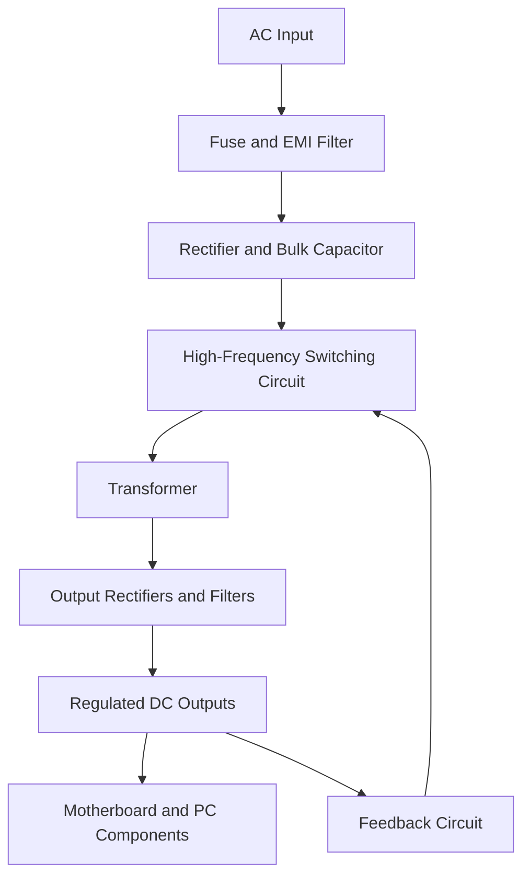

# Final-Module-Assignment-Peripherals-and-power-supply
# Final Module Assignment: Peripherals and Power Supply

## Introduction

This assignment covers computer peripherals, power supply systems, device troubleshooting, operating system installation, and basic computer maintenance. It includes practical steps, safety precautions, and verification methods.

## Table of Contents

1. Peripheral Connection Interfaces
2. Printer Connection Guide
3. Real-World Applications of SMPS and UPS
4. Internal Components of a PC SMPS
5. Common PC Power Connectors
6. Connecting an SMPS in a Gaming PC
7. Keyboard and Mouse Troubleshooting
8. Bluetooth Headphones Troubleshooting
9. Webcam Not Detected in Zoom
10. Windows Printer Offline Troubleshooting
11. USB Webcam Setup
12. Local Printer Installation
13. Printer Detection Using Device Manager
14. Camera Works in Windows but Not in Zoom
15. Checking System Information
16. Creating a Bootable Linux USB
17. Changing macOS Wallpaper and Language
18. Creating an Ubuntu User Account
19. Installing Windows 10
20. Safety Checklist
21. Conclusion

---

## 1. Peripheral Connection Interfaces

| Interface | Example | Advantages | Disadvantages |
|---|---|---|---|
| USB | Keyboard, mouse, printer | Easy to connect, reliable, widely supported | Requires a physical cable |
| Bluetooth | Wireless headphones, mouse | Wireless and portable | Limited range; requires pairing and battery power |
| Wi-Fi | Network printer, scanner | Allows wireless sharing between devices | Depends on network availability and signal strength |

## 2. Printer Connection Guide

1. Connect the printer to a power source and turn it on.
2. Load paper and check the ink or toner.
3. Connect the printer using USB or connect it to the same Wi-Fi network as the computer.
4. Open **Settings → Devices → Printers & scanners** in Windows 10.
5. Select **Add a printer or scanner**.
6. If the printer is not detected, install the correct driver from the manufacturer's official website.
7. Select the printer and choose **Manage → Print a test page**.

**Expected Result:** The printer appears in Windows and successfully prints a test page.

## 3. Real-World Applications of SMPS and UPS

### Devices Using SMPS

| Device | Reason |
|---|---|
| Desktop computer | Converts AC mains power into regulated DC voltages for computer components |
| Laptop charger | Converts AC power into suitable DC power for the laptop |
| LED television | Supplies regulated DC power to the display and internal circuits |

### Devices Commonly Protected by UPS

| Device | Reason |
|---|---|
| Desktop computer | Provides temporary backup power during an outage |
| Wi-Fi router | Maintains network connectivity during short power interruptions |

## 4. Internal Components of a PC SMPS

A Switch Mode Power Supply (SMPS) converts AC electricity into regulated DC power.

**Main components:**
- AC input and fuse
- EMI filter
- Rectifier and bulk capacitor
- High-frequency switching circuit
- High-frequency transformer
- Output rectifiers and filters
- Feedback and protection circuits

### SMPS Block Diagram

**Safety:** Never open an SMPS enclosure. Its internal capacitors may retain dangerous electrical charge even when unplugged.

## 5. Common PC Power Connectors

| Connector | Use | Safety Tip |
|---|---|---|
| 24-pin ATX | Main motherboard power | Align the latch before connecting |
| 4/8-pin CPU/EPS | CPU power | Use the correct CPU/EPS cable |
| SATA power | SATA SSDs, HDDs and accessories | Align the keyed connector correctly |
| 4-pin Molex | Older drives and accessories | Check orientation before insertion |
| PCIe 6/8-pin | Compatible graphics cards | Use the correct GPU power cable |
| 12V-2x6 / 12VHPWR | Supported modern graphics cards | Fully seat the connector and avoid sharp bends near the plug |

## 6. Connecting an SMPS in a Gaming PC

1. Shut down the computer, switch off the PSU, and disconnect the power cable.
2. Mount the PSU securely in the PC case.
3. Connect the 24-pin ATX cable to the motherboard.
4. Connect the 4/8-pin CPU/EPS cable near the processor socket.
5. Connect the appropriate PCIe or 12V-2x6/12VHPWR power cable to the graphics card, if required.
6. Connect SATA power cables to compatible SATA drives and accessories.
7. Connect SATA data cables from SATA drives to the motherboard.
8. An M.2 NVMe SSD normally receives power through its motherboard socket.
9. Organize cables away from fans and check all connections against the component manuals.
10. Reconnect power and test the system.

**Important:** Never mix modular PSU cables from different PSU models unless the manufacturer explicitly confirms compatibility. Incorrect cables can damage components.

## 7. Keyboard and Mouse Troubleshooting

| Problem | Solution |
|---|---|
| Device not detected | Reconnect it and try another USB port |
| Wireless device not responding | Check batteries, power switch and receiver |
| Keyboard keys not working | Clean the keyboard and check for stuck keys |
| Mouse cursor moving erratically | Clean the sensor and use a suitable surface |
| Device works on another PC only | Check drivers and USB ports on the original computer |

**Verification:** Test the keyboard or mouse in another USB port or computer if available.

## 8. Bluetooth Headphones Troubleshooting

1. Charge the headphones and turn them on.
2. Enable Bluetooth on the computer.
3. Open **Settings → Devices → Bluetooth & other devices**.
4. Put the headphones into pairing mode.
5. Select **Add Bluetooth or other device → Bluetooth**.
6. Select the headphones from the available devices.
7. Open **Settings → System → Sound** and select the headphones as the output device.
8. Check volume and mute settings.
9. If the issue continues, remove the device, pair it again, and restart the computer.

**Expected Result:** Audio plays through the Bluetooth headphones.

## 9. Webcam Not Detected in Zoom

1. Check the webcam's USB connection.
2. Try another USB port.
3. Open the Windows Camera app to test the webcam.
4. In Windows 10, open **Settings → Privacy → Camera**.
5. Enable camera access and access for desktop applications.
6. Close other applications that may be using the webcam.
7. Open Zoom → **Settings → Video**.
8. Select the correct camera.
9. Restart Zoom and update it if necessary.

**Expected Result:** The webcam preview appears in Zoom.

## 10. Windows Printer Offline Troubleshooting

1. Check that the printer is powered on.
2. Check the USB cable or Wi-Fi connection.
3. Open **Settings → Devices → Printers & scanners**.
4. Select the printer and open its print queue.
5. In the Printer menu, clear **Use Printer Offline** or **Pause Printing** if enabled.
6. Clear stuck print jobs if necessary.
7. Restart the printer and computer.
8. Run the Windows printer troubleshooter if available.
9. Reinstall the correct printer driver if the issue continues.
10. Print a test page.

**Expected Result:** The printer returns to an online or ready state.

## 11. USB Webcam Setup

1. Connect the webcam to a USB port.
2. Wait for Windows to detect the device.
3. Install the manufacturer's driver if required.
4. Open **Device Manager**.
5. Look under **Cameras**, **Imaging devices**, or another relevant device category.
6. Open the Windows Camera app.
7. Confirm the live preview works.
8. Take a test photo and save it.
9. Open the photo to verify that it was saved correctly.

**Expected Result:** The webcam is detected and the test photo opens successfully.

## 12. Local Printer Installation

1. Connect the printer to power and turn it on.
2. Connect it to the computer using USB.
3. Open **Settings → Devices → Printers & scanners**.
4. Select **Add a printer or scanner**.
5. Select the detected printer.
6. Install the manufacturer's official driver if required.
7. Select the printer and open **Manage**.
8. Choose **Print a test page**.

**Expected Result:** The printer is installed and prints a test page.

## 13. Printer Detection Using Device Manager

1. Disconnect the printer's USB cable.
2. Open Device Manager by right-clicking the Start button.
3. Reconnect the printer.
4. Look under **Printers**, **Print queues**, or **Universal Serial Bus controllers**.
5. Select **Action → Scan for hardware changes** if the printer does not appear.
6. Check for warning symbols or an Unknown device.
7. Install the correct driver from the printer manufacturer's official website if needed.
8. Open Printers & scanners and print a test page.

**Expected Result:** Windows detects the printer and makes it available for printing.

## 14. Camera Works in Windows but Not in Zoom

1. Test the camera in the Windows Camera app.
2. Open **Settings → Privacy → Camera**.
3. Ensure camera access is enabled for desktop applications.
4. Close the Camera app and other video-calling applications.
5. Open Zoom → **Settings → Video**.
6. Select the correct webcam.
7. Restart Zoom.
8. Update Zoom and check the webcam driver if necessary.

**Conclusion:** If the camera works in Windows but not in Zoom, check Zoom's camera selection, privacy permissions, and possible application conflicts.

## 15. Checking System Information in Windows

1. Press **Win + R**.
2. Type `msinfo32` and press Enter.
3. Open **System Summary**.
4. Locate the Windows version, processor and installed physical memory (RAM).
5. Press **Win + Shift + S** to capture a screenshot.
6. Save the screenshot and review it before submission.

**Evidence Required:** A screenshot showing the operating system version, CPU and RAM. Hide unnecessary personal or device identifiers before sharing.

## 16. Creating a Bootable Linux USB

### Requirements
- USB drive with at least 8 GB capacity
- Linux ISO downloaded from the distribution's official website
- Rufus or another trusted USB creation utility
- Backup of the USB drive's files

### Steps
1. Download an Ubuntu ISO from the official Ubuntu website.
2. Download and open Rufus from its official website.
3. Insert the USB drive.
4. Verify that the correct USB drive is selected.
5. Select the downloaded ISO in Rufus.
6. Use settings appropriate for the target computer.
7. Start the process and confirm the warning that the USB contents will be erased.
8. Wait for the process to complete and safely eject the USB.
9. Restart the computer and open its boot menu.
10. Select the USB device to start the Linux live environment or installer.

**Expected Result:** The computer starts from the bootable USB.

**Safety:** Back up the USB before creating the bootable drive because its existing contents may be erased.

## 17. Changing macOS Wallpaper and Language

### Change Wallpaper
1. Open **System Settings** or **System Preferences**.
2. Select **Wallpaper** or **Desktop & Screen Saver**, depending on the macOS version.
3. Choose a wallpaper or select an image.
4. Confirm that the desktop background changes.

### Change Language
1. Open **System Settings → General → Language & Region**.
2. Add the preferred language if it is not listed.
3. Set it as the preferred language.
4. Follow any prompts to apply the change.
5. Log out or restart if requested.

**Expected Result:** The wallpaper and preferred interface language are updated.

## 18. Creating an Ubuntu User Account and Auto-Login

1. Install Ubuntu using the official installer.
2. Create an account named `gamer` during installation, or open **Settings → Users** after installation.
3. If creating the account after installation, unlock the settings and add the user.
4. Set a strong password and choose the appropriate account type.
5. If available, enable **Automatic Login** for the intended account.
6. Restart and verify the login behaviour.

**Security Note:** Automatic login reduces security because someone with physical access may be able to use the computer without entering a password. Avoid it on shared or portable computers.

**Evidence Required:** A screenshot of the user list or login settings, with private information hidden where appropriate.

## 19. Installing Windows 10 and Post-Installation Settings

### Requirements
- Laptop and charger
- USB drive with at least 8 GB capacity
- Official Windows installation media
- Valid license or digital entitlement
- Backup of important files

### Preparation
1. Back up personal files to an external drive or cloud storage.
2. Download Windows installation media from Microsoft's official website.
3. Create a bootable USB.
4. Keep the laptop connected to its charger.
5. Disconnect unnecessary external drives to reduce the risk of selecting the wrong disk.

### Installation
1. Insert the USB and restart the laptop.
2. Open the boot menu using the key specified by the laptop manufacturer.
3. Select the USB drive.
4. Choose the language, time and keyboard settings.
5. Select **Install now**.
6. Enter the product key if requested, or use the available option to continue and activate later if appropriate for the license.
7. Accept the license terms.
8. Select **Custom: Install Windows only** for a clean installation when appropriate.
9. Carefully identify the target drive and partition.
10. Select the intended partition or suitable unallocated space and continue.

### Partitioning Tips
- Back up all important files before modifying partitions.
- Verify the correct disk and partition before formatting or deleting anything.
- Deleting a partition permanently removes its data.
- Do not delete recovery or data partitions unless you understand their purpose.
- Windows can create the required system partitions when installing to suitable unallocated space.
- If you need to preserve existing files or dual-boot another operating system, stop and review the disk layout before making changes.

### Initial Setup and Privacy
1. Choose the region and keyboard layout.
2. Select the available network and account options.
3. Review the privacy settings instead of accepting every default.
4. Disable optional location access if it is not needed.
5. Review diagnostic data, advertising ID and tailored-experience settings.
6. Allow camera, microphone and location access only to apps that require them.
7. Use a strong password and available sign-in security features.

### Updates and Drivers
1. Open **Settings → Update & Security → Windows Update**.
2. Select **Check for updates**.
3. Install applicable updates and restart when required.
4. Check again for further updates.
5. Open Device Manager and check for devices with warning symbols.
6. Install missing drivers from the laptop manufacturer's official support website.
7. Check activation under **Settings → Update & Security → Activation**.

### Post-Installation Verification
- Confirm that Wi-Fi, audio, display, keyboard, touchpad and webcam work.
- Check that Windows is activated.
- Open Windows Security and confirm protection is enabled.
- Review installed applications and remove only software you recognize and no longer need.
- Set up regular backups.
- Create a restore point if System Protection is available.

**Important Support Note:** Standard Windows 10 support ended on October 14, 2025. In 2026, prefer a supported operating system when compatible with the laptop, or check Microsoft's official information about eligibility for Extended Security Updates.

### Steps That May Need Clarification
- The boot-menu key varies by laptop model.
- Partition choices depend on the current drive layout and whether files must be preserved.
- Driver availability varies by manufacturer and model.
- Activation depends on the license or digital entitlement.
- Privacy settings vary by Windows edition and version.

## 20. Safety Checklist

- [ ] Back up important files before installing an operating system or changing partitions.
- [ ] Download drivers and installation media from official sources.
- [ ] Disconnect power before connecting or disconnecting internal PC components.
- [ ] Never open an SMPS enclosure.
- [ ] Use the correct CPU/EPS and GPU power cables.
- [ ] Never mix modular PSU cables unless compatibility is confirmed by the manufacturer.
- [ ] Check the selected drive before formatting or erasing data.
- [ ] Review privacy permissions and use strong passwords.
- [ ] Test devices after installation and document any remaining errors.

## 21. Conclusion

This assignment explains how to connect and troubleshoot computer peripherals, understand SMPS and UPS applications, identify PC power connectors, and configure Windows, Linux and macOS systems. Careful installation, official drivers, electrical safety, privacy awareness and verification testing help maintain a reliable computer system.

## Reference Modules

1. [Module 1 — Peripherals and Power Supply](https://github.com/shaktiboradia67-cmyk/Peripherals-and-power-supply/blob/df5d6fc9551ddee86647c1f703119f283f49795f/README.md)
2. [Module 2 — Peripherals and Power Supply 2](https://github.com/shaktiboradia67-cmyk/Peripherals-and-power-supply-2/blob/c166afe36d801f64dee3a040f8512442dbd43fe6/README.md)
3. [Module 3 — Peripherals and Power Supply 3](https://github.com/shaktiboradia67-cmyk/Peripherals-and-power-supply-3/blob/22f54c8246149c388917949593362415dee0d3c2/README.md)
4. [Module 4 — Peripherals and Power Supply 4](https://github.com/shaktiboradia67-cmyk/Peripherals-and-power-supply-4/blob/e10fa05c230e0bace796d44a5d316c6744539044/README.md)
5. [Module 5 — Peripherals and Power Supply 5](https://github.com/shaktiboradia67-cmyk/Peripherals-and-power-supply-5/blob/666f1dc0310fee2703291cfff6df578051db9c9f/README.md)
